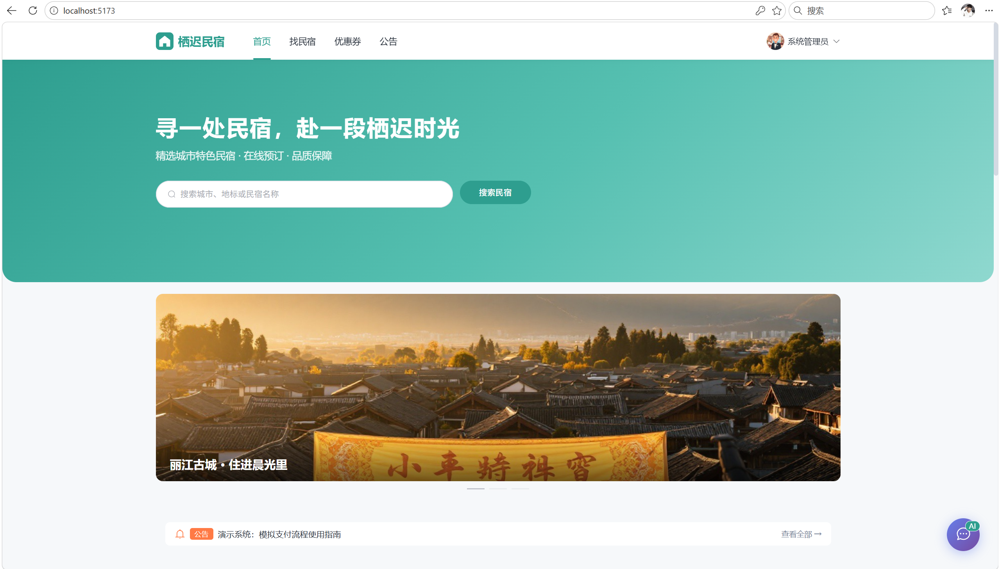
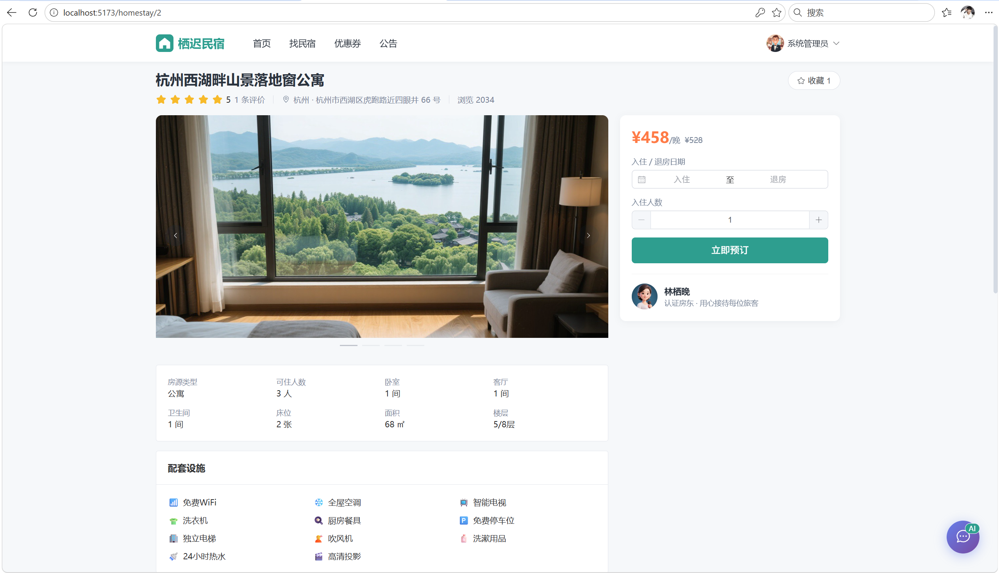
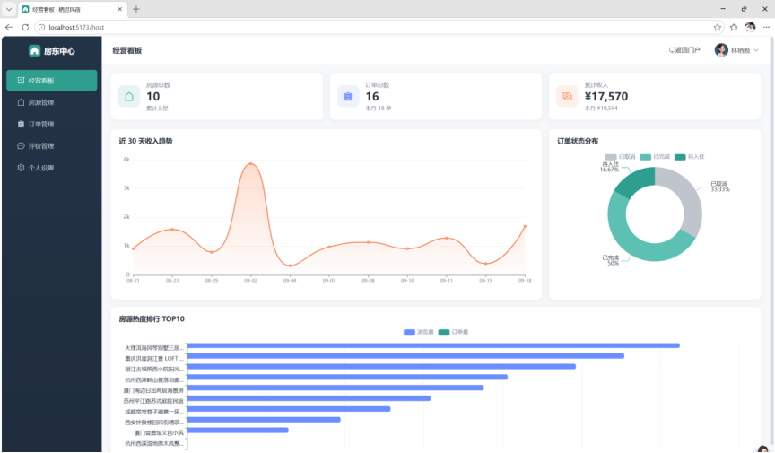
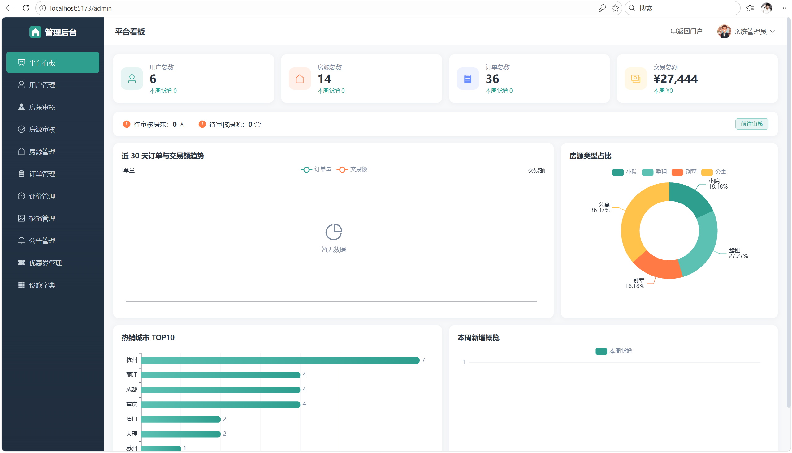
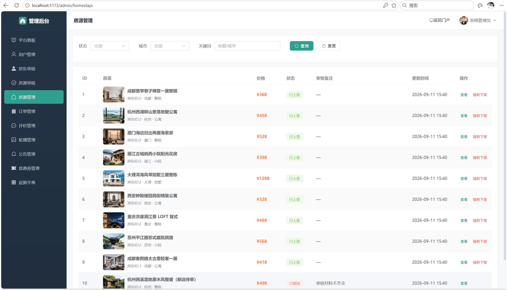

# 栖迟民宿管理系统（bnbms）

个人独立实践项目：基于 Spring Boot + Vue 3 的三端（租客门户 / 房东端 / 管理员端）民宿管理系统，使用 Trae AI 编程工具辅助开发。

## 项目概览

围绕民宿浏览、预订与经营管理，提供租客、房东和管理员三个角色的功能入口。源码包含前后端工程及数据库初始化脚本，无需运行即可通过以下截图了解主要界面。

| 使用端 | 主要功能 |
| --- | --- |
| 租客门户 | 房源搜索与详情、收藏、预订订单、优惠券、评价 |
| 房东端 | 经营看板、房源管理、订单管理、评价回复 |
| 管理员端 | 平台看板、用户管理、房东及房源审核、订单与内容管理 |

扩展功能包括支付宝沙箱支付、智能客服（本地规则答疑，预留通义千问与 Coze 接口调用能力）以及基于收藏和订单偏好的房源推荐。支付为沙箱演示，使用外部 AI 服务需自行配置密钥。

## 项目亮点

### 优惠券：支持营销发放与核销

实现优惠券模块，支持优惠券发放、用户领取及下单使用核销，将营销优惠融入民宿预订流程，帮助运营人员开展促销活动，提升优惠券管理效率与用户预订体验。

### AI 智能助手：提供智能咨询答疑

实现 AI 智能助手模块，为用户提供平台使用、民宿预订及优惠券规则等咨询答疑，帮助用户快速了解操作流程，减少重复咨询，提升民宿运营效率和用户体验。

智能助手已实现本地关键词规则答疑，并编写了通义千问与 Coze 的接口调用逻辑。当前通义千问密钥通过环境变量读取，实际调用效果尚未验证；Coze 未配置启用。外部 AI 服务未配置或调用失败时，系统使用本地规则回复。
## 开发说明

本项目由本人独立完成，开发过程中使用 Trae AI 编程工具辅助。本仓库用于展示个人实践成果，AI 辅助开发情况如实披露。

## 界面展示

### 租客门户首页



### 民宿详情



### 房东经营看板



### 管理员平台看板



### 管理员房源管理



## 技术栈

- **后端**：Spring Boot 2.7.18 + Java 8 + MyBatis-Plus 3.5.5 + MySQL 8.0 + Redis 5.0.14 + JWT(jjwt 0.11.5) + Hutool + Lombok + spring-security-crypto(BCrypt)
- **前端**：Vue3 + Vite 5.4.21 + Vue Router 4 + Pinia + Element Plus 2.8.4 + Axios + ECharts 5
- **构建工具**：Maven 3.9.x / npm

## 环境要求

| 组件 | 版本 | 说明 |
| --- | --- | --- |
| JDK | 1.8（建议 8u300+） | JAVA_HOME 需指向 JDK8 |
| Maven | 3.9.x | 项目无独立 wrapper，请安装 Maven |
| Node.js | 18+（实测 v24） | 用于前端构建与开发 |
| MySQL | 8.0+（实测 8.0.29） | 字符集 utf8mb4 |
| Redis | 5.0+（实测 5.0.14） | 请自行安装，本地副本可保留已有程序 |

## 目录结构

```
bnbms/
├── backend/          # 后端 Spring Boot 工程
├── frontend/         # 前端 Vue3 + Vite 工程
├── tools/redis/      # 免安装 Redis 5.0.14（Windows）
└── .trae/specs/      # 规格与实施计划（spec.md / tasks.md）
```

## 快速开始

### 1. 初始化数据库

```bash
# 登录 MySQL（root/123456）
mysql -uroot -p123456

# 在 mysql 提示符下依次执行
source <项目目录>/backend/src/main/resources/db/schema.sql;
source <项目目录>/backend/src/main/resources/db/data.sql;
```

> schema.sql 与 data.sql 均可重复执行：schema 用 `DROP TABLE IF EXISTS` 重建，data 用 `TRUNCATE` 重置后插入，自增 ID 固定。

### 2. 启动 Redis

```powershell
# 方式一：使用项目内置免安装版
<项目目录>\tools\redis\redis-server.exe --port 6379

# 验证
<项目目录>\tools\redis\redis-cli.exe ping
# 应返回 PONG
```

> 重启电脑后需重新启动 redis-server。

### 3. 启动后端

```bash
cd <项目目录>\backend
mvn spring-boot:run
# 或用绝对路径的 mvn：
# C:\Users\{用户}\.m2\wrapper\dists\apache-maven-3.9.16-bin\*\apache-maven-3.9.16\bin\mvn.cmd spring-boot:run
```

后端启动后监听 `http://localhost:8080`，健康检查：`GET /api/health`。

### 4. 启动前端

```bash
cd <项目目录>\frontend
npm install      # 首次运行
npm run dev     # 开发模式，监听 http://localhost:5173
```

浏览器访问 `http://localhost:5173` 即可使用。

## 演示账号

所有演示账号密码统一为 `123456`（BCrypt 加密存储）。

| 用户名 | 角色 | 姓名 | 说明 |
| --- | --- | --- | --- |
| admin | ADMIN | 系统管理员 | 管理员端全部功能 |
| host1 | HOST | 林栖晚 | 已审核房东，名下 10 套房源 |
| host2 | HOST | 沈渡 | 已审核房东，名下 4 套房源 |
| tenant1 | TENANT | 苏晓 | 租客，名下 5 个收藏 |
| tenant2 | TENANT | 陈默 | 租客，名下 3 个收藏 |
| hopending | TENANT | 周望 | 房东入驻申请待审核（host_status=PENDING） |
| disabled | TENANT | 吴禁用 | 已禁用账号（status=0），登录被拒 |

## 三端入口

| 端 | 入口 | 核心功能 |
| --- | --- | --- |
| 租客门户 | `/`（首页） | 浏览/搜索房源、收藏、下单、支付、评价、我的订单 |
| 房东端 | `/host` | 经营看板、房源管理、订单管理、评价回复 |
| 管理员端 | `/admin` | 平台看板、用户/房东/房源审核、订单/评价/轮播/公告管理 |

## 端口与常见问题

### 端口

| 服务 | 端口 |
| --- | --- |
| 后端 API | 8080 |
| 前端 dev | 5173 |
| MySQL | 3306 |
| Redis | 6379 |

### 前端构建产物本地托管（可选）

```bash
# 前端构建
cd <项目目录>\frontend
npm run build   # 产物输出到 frontend/dist

# 复制到后端静态资源目录由 Spring Boot 托管
xcopy /E /I /Y dist\* ..\backend\src\main\resources\static\
```

复制后重启后端，访问 `http://localhost:8080` 即可同时使用前后端（Vite 代理不再需要）。

### 常见问题

1. **后端启动报数据库连接失败**：确认 MySQL 已启动、`bnbms` 库已创建、`application.yml` 中 `password` 与本机一致（默认 123456，可用环境变量 `MYSQL_PASSWORD` 覆盖）。
2. **登录提示「验证码错误或已过期」**：验证码 5 分钟有效且一次性，刷新验证码图片重新输入。
3. **登录提示「系统繁忙」**：通常是 Redis 未启动，执行 `redis-cli ping` 确认返回 PONG。
4. **图片不显示**：上传图片落盘在 `backend/uploads/`，由后端 `/uploads/**` 静态映射提供；生产环境需配置 `bnbms.upload-dir` 为绝对路径。
5. **端口被占用**：8080 被占可用 `Get-NetTCPConnection -LocalPort 8080` 找 PID 后 `Stop-Process -Id {PID} -Force`；5173 被占 Vite 会自动切下一个端口。
6. **跨角色访问被拒（403）**：系统基于 JWT + `@RequireRole` 注解做接口级权限控制，租客不能访问房东/管理员接口，反之亦然。
7. **订单超时自动取消**：待支付订单 30 分钟未支付会被定时任务（每分钟扫描）自动取消并回放房源 order_count。

## 本地私密配置

公开配置使用环境变量读取敏感信息：`JWT_SECRET`、`ALIPAY_APP_ID`、`ALIPAY_PRIVATE_KEY`、`ALIPAY_PUBLIC_KEY`。JWT_SECRET 请设置为足够长的随机字符串（至少 32 字节）。

本地已有的 `backend/src/main/resources/application-local.yml` 会自动加载，并已被 `.gitignore` 排除，保留原有登录和支付宝沙箱配置。不要上传或分享此文件。新下载项目的使用者需要自行设置上述环境变量或创建自己的本地配置。

数据库密码可通过 `MYSQL_PASSWORD` 设置；AI 服务密钥可通过 `DASHSCOPE_API_KEY` 设置。未配置支付密钥时支付功能不可用；未配置 AI 服务时使用本地规则回复。

`node_modules`、`target`、`dist`、本地上传图片及 Redis 程序不纳入源码仓库。上传图片目录保留在本地，下载源码后需自行准备图片。